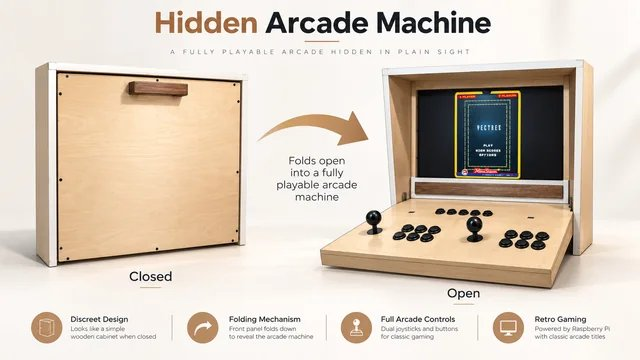
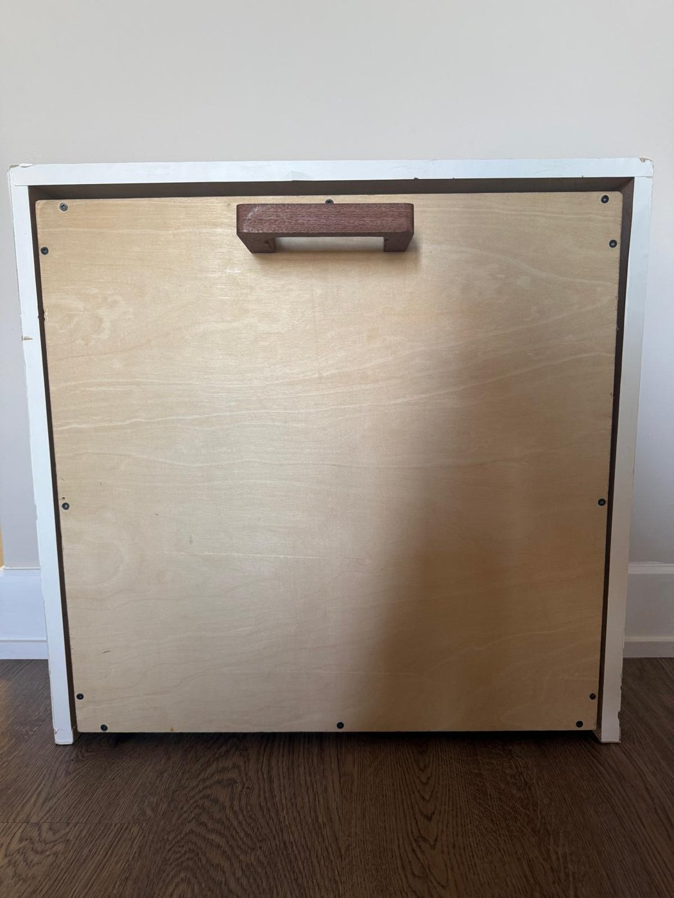
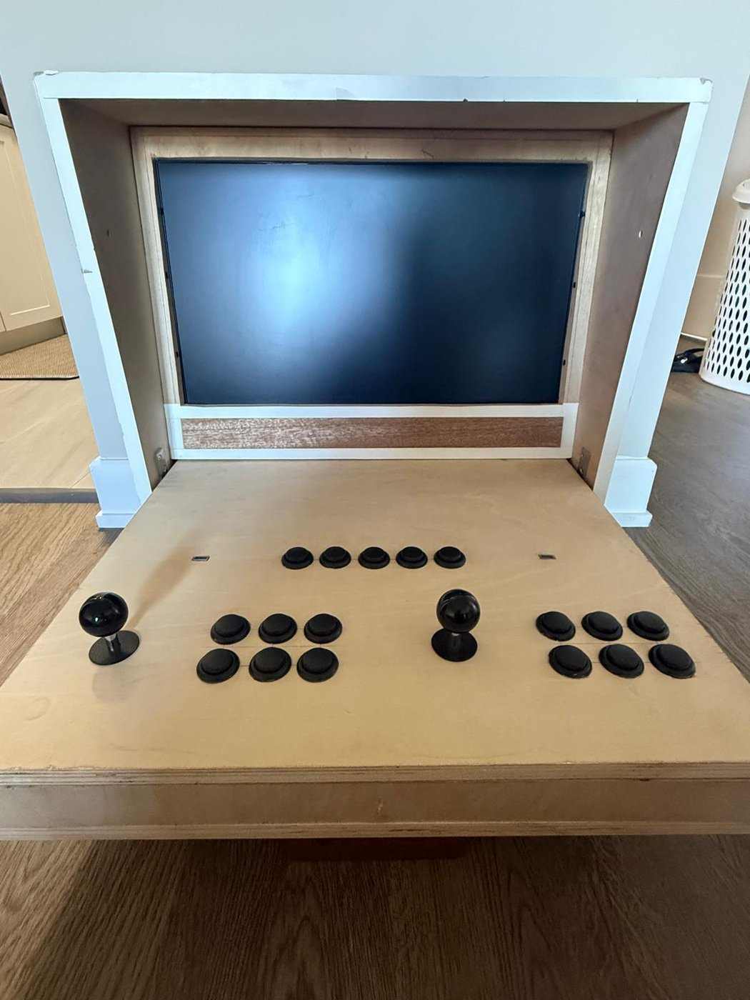
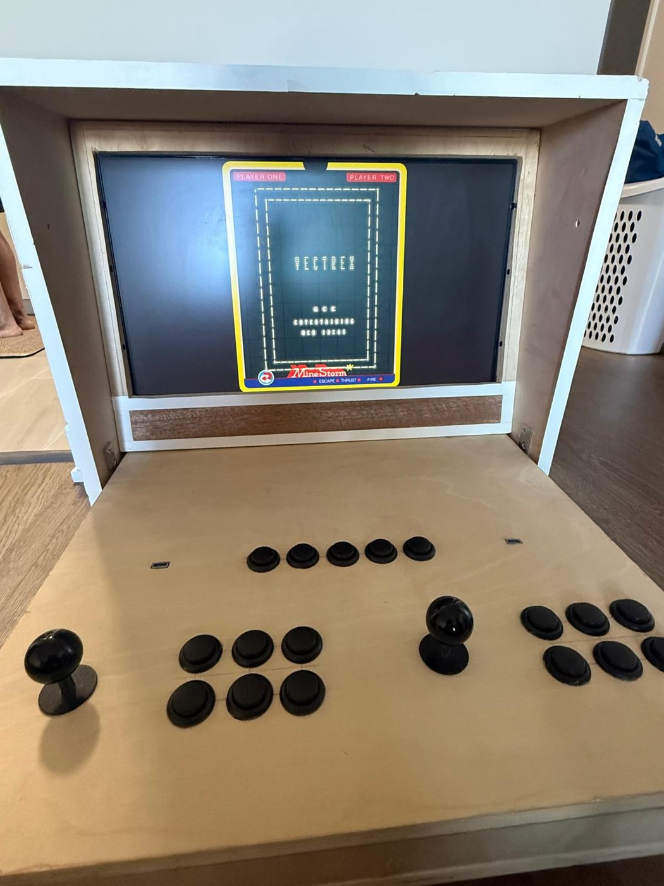
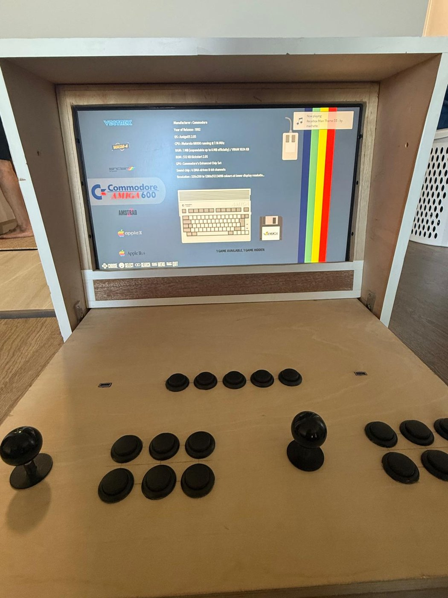

<h1 align="center">Foldable Raspberry Pi 5 Arcade Machine</h1>

<b>A two-player arcade cabinet that folds closed like furniture, built end to end: CAD, woodworking, electronics and software.</b>

  
  
  

---

  

Most Raspberry Pi arcade builds are a Pi in a box. I wanted something you'd keep in a living room: a cabinet that **closes like a piece of furniture** and **opens to reveal a full two-player arcade** with joysticks, buttons, a screen and sound.

## The build

### 1. Design in CAD
I modelled the whole cabinet in **Autodesk Fusion 360** before cutting anything: overall dimensions, the folding structure, screen placement, control-panel layout, and where every internal component would sit. The CAD model also produced the measurements for the woodwork.

### 2. Woodworking
The cabinet was my first woodworking project. In my former high school's workshop I measured, cut, fitted and assembled every wooden part myself, working from the CAD dimensions.

### 3. Electronics
- A **custom control board** made on copper-clad fibreglass, wiring the arcade **joysticks and buttons** for two players to the **Raspberry Pi 5**
- Integrated **display** and **audio system**

### 4. Software
- Arcade-style games inspired by classics like **Flappy Bird, Mario, Pac-Man and Space Invaders**
- Input mapping so every game works from the physical joysticks and buttons
- Display and sound set up so the cabinet runs standalone from its own controls
- Runs **Recalbox**, so the cabinet also plays classic systems such as the Vectrex and Commodore Amiga

### 5. Debugging and integration
A large part of the project was spent making separate systems work together reliably: fixing input mappings, tracing faulty hardware connections, tuning game performance and sorting out audio.

## Photos

| Closed | Open |
|---|---|
|  |  |

| Playing Vectrex MineStorm | Recalbox system menu |
|---|---|
|  |  |

The control panel has two joysticks, six action buttons per player and a row of five function buttons.

## Skills used

| Area | What I did |
|---|---|
| CAD | Full cabinet and folding mechanism in Fusion 360 |
| Fabrication | Measuring, cutting and assembling the wood cabinet |
| Electronics | Custom control board, wiring, soldering, display and audio integration |
| Embedded computing | Raspberry Pi 5 setup and configuration |
| Software | Arcade games and control-input mapping |
| Testing | Hardware and software debugging across the whole system |

## What I learned

This project took me well beyond software: CAD, fabrication, electronics and system integration in one build. The most rewarding part was watching something that only existed as a CAD model become a physical, working machine.

---

Built by **Darshil Patel** — [LinkedIn](https://www.linkedin.com/in/darshilkumarpatel1) · [GitHub](https://github.com/Darshil2903)
